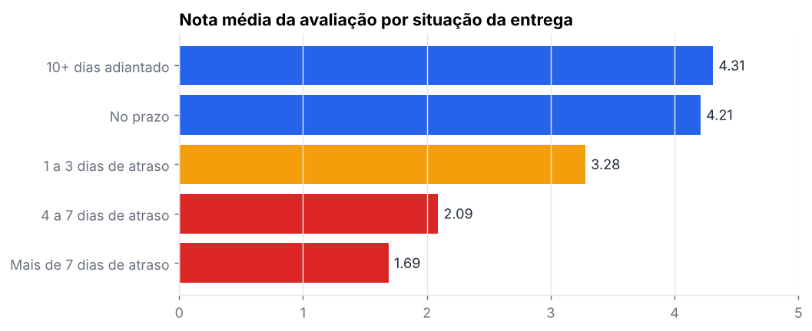
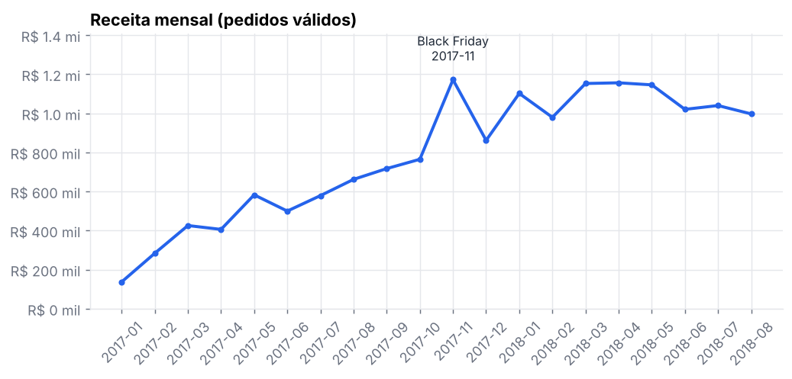
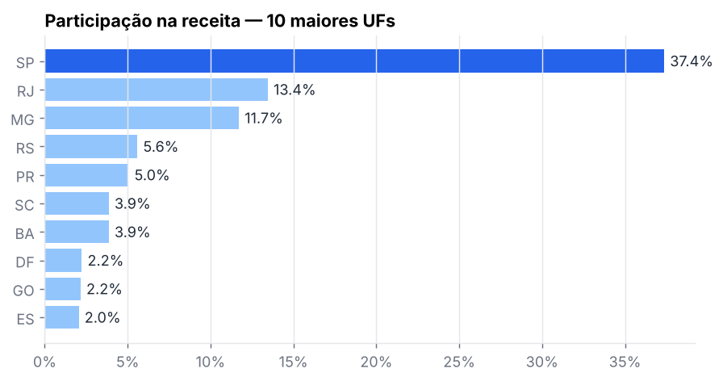
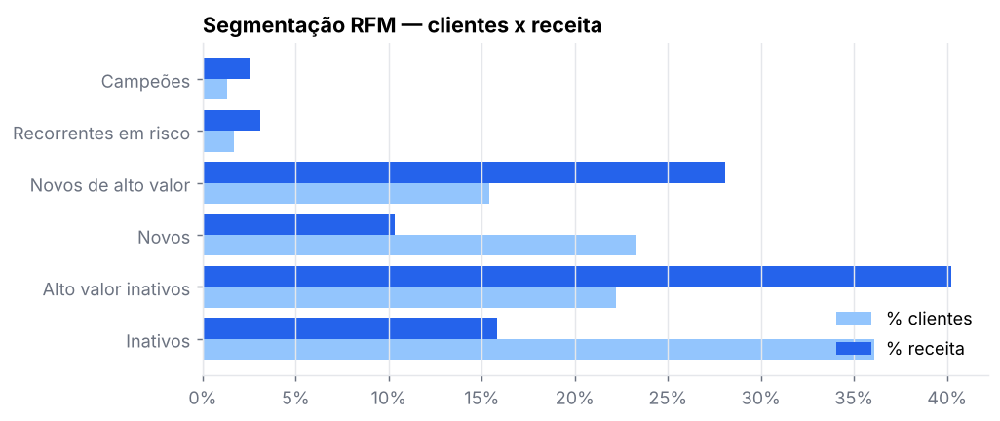
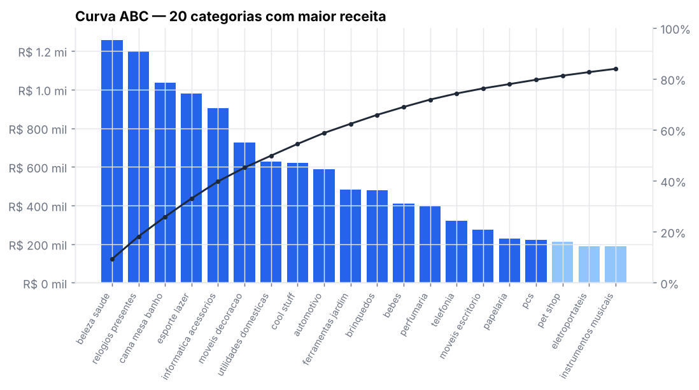

# Olist E-commerce Analytics

**Análise de 98 mil pedidos reais de e-commerce brasileiro, da modelagem em SQL às recomendações de negócio.**

[](https://github.com/GabrielVelosoDEV/olist-ecommerce-analytics/actions/workflows/ci.yml)


🔗 **Dashboard interativo:** https://gabrielvelosodev.github.io/olist-ecommerce-analytics/

---

## Contexto

A [Olist](https://olist.com/) conecta pequenos lojistas aos grandes marketplaces brasileiros. A empresa publicou uma base
anonimizada com **~100 mil pedidos feitos entre 2016 e 2018**, com clientes, vendedores, produtos, pagamentos, prazos de
entrega e avaliações.

O objetivo deste projeto é responder, com dados, perguntas que uma área de **inteligência de mercado ou BI** levaria para a
liderança:

| # | Pergunta de negócio | Consulta |
|---|---|---|
| 1 | Como evoluíram receita, pedidos e ticket médio? | [`q01`](sql/analysis/q01_vendas_mensais.sql) |
| 2 | Onde está a receita e quanto pesa o frete em cada UF? | [`q02`](sql/analysis/q02_receita_por_uf.sql) |
| 3 | Quais categorias concentram a receita (curva ABC)? | [`q03`](sql/analysis/q03_categorias_pareto.sql) |
| 4 | Atraso na entrega derruba a avaliação? | [`q04`](sql/analysis/q04_entrega_vs_avaliacao.sql) |
| 5 | Quais UFs têm a pior logística? | [`q05`](sql/analysis/q05_atraso_por_uf.sql) |
| 6 | Os clientes voltam? Retenção por coorte | [`q06`](sql/analysis/q06_recompra_coortes.sql) |
| 7 | Quem são os clientes de valor? Segmentação RFM | [`q07`](sql/analysis/q07_rfm.sql) |
| 8 | Como o cliente paga? | [`q08`](sql/analysis/q08_pagamentos.sql) |
| 9 | Quão concentrada é a base de vendedores? | [`q09`](sql/analysis/q09_vendedores_concentracao.sql) |

## Principais resultados

| Indicador | Valor |
|---|---|
| Receita de pedidos válidos | **R$ 15,7 milhões** |
| Pedidos / clientes únicos | 98.199 / 94.983 |
| Ticket médio | R$ 160,24 |
| Crescimento da receita (1º sem/2018 vs 1º sem/2017) | **+181%** |
| Clientes que compraram mais de uma vez | **3,0%** |
| Pedidos entregues no prazo | 93,2% |

**1. Atraso na entrega é o maior detrator de satisfação.** A nota média cai de **4,21** nos pedidos entregues no prazo
para **1,69** quando o atraso passa de 7 dias, e **80%** desses pedidos recebem nota 1 ou 2.



**2. O crescimento foi forte, mas estabilizou.** A receita quase triplicou em um ano, com pico na Black Friday de
novembro/2017, e em 2018 se mantém perto de R$ 1 milhão por mês.



**3. A receita é muito concentrada no Sudeste.** São Paulo responde por **37%** da receita e o Sudeste por **65%**.
Fora dele, o frete pesa mais sobre o valor do produto (28% em Roraima e 26% no Maranhão, contra 14% em SP).



**4. Recompra quase inexistente.** Só **3%** dos clientes voltam a comprar e a retenção mensal por coorte fica abaixo de 1%.
Na segmentação RFM, os clientes de alto valor que não compram há mais de 300 dias concentram **40%** da receita histórica.



**5. Poucas categorias e poucos vendedores fazem o resultado.** 17 de 74 categorias geram 80% da receita, e os 10% maiores
vendedores respondem por **67%** dela.



### Recomendações

1. **Resolver o atraso antes de ampliar o alcance**, começando pelo Nordeste, onde estão as menores taxas de entrega no prazo (AL 79%, MA 83%).
2. **Criar uma régua de recompra** para os segmentos "novos de alto valor" e "alto valor inativos".
3. **Programa de contas-chave para os maiores vendedores**, com metas de prazo de entrega.
4. **Rever a política de frete** nas UFs em que ele passa de 20% do valor do produto.

## Arquitetura

```
data/raw/*.csv.gz          8 arquivos originais (compactados)
        │  src/pipeline.py
        ▼
SQLite  ├── raw_*          tabelas espelho, com tipos e chaves     sql/01_schema.sql
        ├── stg_*          limpeza e regras de negócio (views)     sql/02_staging.sql
        └── fct_* / vw_*   fatos analíticos materializados         sql/03_marts.sql
        │  src/analysis.py   (9 consultas em sql/analysis/)
        ▼
reports/  results/*.csv · kpis.json · figures/*.png
        │  src/build_dashboard.py
        ▼
docs/index.html            dashboard publicado no GitHub Pages
```

Destaques técnicos:

- **Modelagem em camadas** (raw → staging → marts), no padrão usado em ferramentas como o dbt.
- **SQL analítico:** CTEs, funções de janela (`ROW_NUMBER`, `NTILE`, `SUM() OVER`), análise de coortes e RFM.
- **Qualidade de dados testada:** 8 testes com `pytest` (carga completa, chave única, integridade referencial, faixas válidas
  e reconciliação da receita), rodando a cada push no GitHub Actions.
- **Tratamento de casos reais da base:** avaliações duplicadas por pedido, produtos sem categoria, pedidos com vários
  pagamentos e meses de borda com poucos registros.

## Como rodar

```bash
git clone https://github.com/GabrielVelosoDEV/olist-ecommerce-analytics.git
cd olist-ecommerce-analytics
pip install -r requirements.txt

make all      # pipeline + análise + dashboard   (ou rode os 3 scripts de src/ em ordem)
make test     # testes de qualidade de dados
```

O banco `data/olist.db` é gerado em cerca de 4 segundos.

## Estrutura

```
├── data/raw/              dados brutos da Olist (.csv.gz)
├── sql/
│   ├── 01_schema.sql      camada raw
│   ├── 02_staging.sql     camada staging
│   ├── 03_marts.sql       camada marts
│   └── analysis/          9 consultas de negócio
├── src/
│   ├── pipeline.py        ELT para SQLite
│   ├── analysis.py        consultas, KPIs e gráficos
│   └── build_dashboard.py dashboard estático
├── reports/               resultados, KPIs e gráficos gerados
├── docs/index.html        dashboard (GitHub Pages)
└── tests/                 testes de qualidade de dados
```

## Dados e licença

Dados: [Brazilian E-Commerce Public Dataset by Olist](https://www.kaggle.com/datasets/olistbr/brazilian-ecommerce),
licença [CC BY-NC-SA 4.0](https://creativecommons.org/licenses/by-nc-sa/4.0/). O código deste repositório está sob licença MIT.

---

Feito por **Gabriel Veloso** · [LinkedIn](https://www.linkedin.com/in/gabrielvelosodev/) · [GitHub](https://github.com/GabrielVelosoDEV)
